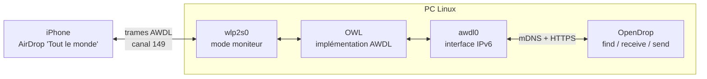

<!-- clean-readme: type=recherche; langue=fr; v=2 -->
# Preuve de concept AirDrop sur Linux

Ce projet teste si un PC sous Linux (Fedora, carte Wi-Fi Realtek RTL8852BE) peut échanger des fichiers en AirDrop avec un iPhone, sans application côté Apple. Il s'appuie sur OWL, qui réimplémente le protocole Wi-Fi d'Apple (AWDL), et sur OpenDrop, qui réimplémente AirDrop par-dessus. Un script Bash enchaîne la mise en place et remet le Wi-Fi en état à la fin. Aujourd'hui, l'iPhone voit le PC et s'y connecte, mais aucun fichier n'a encore été reçu.

> **État** : En pause. La couche AWDL fonctionne et l'iPhone se connecte au PC, mais les réponses du PC n'arrivent pas à l'iPhone. La clé USB MediaTek MT7612U est reçue et reconnue. Reprise avec les essais sur cette clé, pour vérifier si la carte Wi-Fi est en cause.

## Avertissement

Ce dépôt est un travail d'étude personnel sur un protocole propriétaire. Les scripts passent la carte Wi-Fi en mode moniteur, émettent des trames brutes et demandent les droits root : le Wi-Fi habituel est coupé pendant les essais.

## Sommaire

- [Avertissement](#avertissement)
- [Contexte](#contexte)
- [Question de recherche](#question-de-recherche)
- [Avancement](#avancement)
- [Résultats principaux](#résultats-principaux)
- [Méthode](#méthode)
- [Reproduire](#reproduire)
- [Structure du dépôt](#structure-du-dépôt)
- [Matériel](#matériel)
- [Questions ouvertes](#questions-ouvertes)
- [Limites](#limites)
- [Crédits](#crédits)

## Contexte

AirDrop ne passe pas par le réseau local. Il crée un réseau Wi-Fi direct entre les appareils, avec un protocole propriétaire d'Apple. Pour qu'un PC Linux y participe, sa carte Wi-Fi doit accepter des modes de fonctionnement que les pilotes grand public gèrent rarement.

## Question de recherche

Une carte Wi-Fi intégrée courante, ici la RTL8852BE avec le pilote `rtw89`, peut-elle faire tourner AWDL et échanger un fichier AirDrop avec un iPhone ? Si oui, que faut-il contourner pour y arriver ?

## Avancement

La couche AWDL fonctionne sur ma carte grâce à deux contournements : OWL se synchronise avec l'iPhone. En mode `receive`, l'iPhone voit le PC et ouvre des connexions TLS vers le port 8771. Presque aucune réponse du PC n'arrive à l'iPhone, donc aucun fichier n'a été reçu. Les modes `find` et `send` sont bloqués par l'absence d'annonce Bluetooth LE dans OpenDrop.

Je soupçonne la carte. La clé USB MT7612U est reçue (le 2026-11-24) : le pilote `mt76x2u` la reconnaît sans installation et elle gère le mode moniteur actif. Les essais AWDL avec cette clé restent à faire. Détail dans [ROADMAP.md](ROADMAP.md).

## Résultats principaux

1. **R1** : la RTL8852BE injecte des trames en 5 GHz (canal 157), mais n'a pas de mode moniteur actif. [Détail](RESULTATS.md#r1)
2. **R2** : en mode moniteur, la carte ne reçoit que sur le dernier canal utilisé par le firmware. Un point d'accès éphémère sur le canal voulu contourne le problème. [Détail](RESULTATS.md#r2)
3. **R3** : avec ces deux contournements, OWL se synchronise avec l'iPhone, qui voit le PC et ouvre des connexions TLS. [Détail](RESULTATS.md#r3)
4. **R4** : les réponses TLS du PC n'arrivent pas à l'iPhone. La taille des segments TCP n'est pas la cause. [Détail](RESULTATS.md#r4)
5. **R5** : `find` et `send` ne trouvent pas l'iPhone, qui n'ouvre son serveur AirDrop qu'après une annonce Bluetooth LE. [Détail](RESULTATS.md#r5)

Les 14 essais et les pistes écartées sont dans [RESULTATS.md](RESULTATS.md).

## Méthode

AirDrop empile quatre briques : Bluetooth LE (annonce), AWDL (réseau Wi-Fi pair à pair sur les canaux 6, 44 et 149), mDNS / DNS-SD (service `_airdrop._tcp`) et HTTPS (échange d'identité, puis fichier). OWL prend en charge AWDL, OpenDrop le mDNS et le HTTPS. Aucun des deux ne fait l'annonce Bluetooth : il faut ouvrir la feuille de partage AirDrop sur l'iPhone pour qu'il active AWDL.



J'observe chaque essai avec les journaux d'OWL et d'OpenDrop, et avec des captures `tshark` de `awdl0` et des trames Wi-Fi brutes. Le détail du script et du protocole est dans [RESULTATS.md](RESULTATS.md#méthode).

## Reproduire

### Prérequis

- Linux avec une carte Wi-Fi qui accepte le mode moniteur et l'injection (voir [Matériel](#matériel))
- `cmake`, `libpcap-devel`, `libev-devel`, `libnl3-devel`, `wireshark-cli` (`tshark`), `aircrack-ng`, `iw`, `nmcli`, `nft`, `patch`, Python 3
- OWL compilé dans `~/.local/src/owl`, OpenDrop 0.13.0 avec les correctifs de `patches/`
- Un iPhone avec AirDrop réglé sur "Tout le monde"
- Testé sur : Fedora 44, noyau 7.2.15, Python 3.14

Installation :

```bash
sudo dnf install cmake libpcap-devel libev-devel libnl3-devel wireshark-cli aircrack-ng
git clone --recursive https://github.com/seemoo-lab/owl.git ~/.local/src/owl
cmake -S ~/.local/src/owl -B ~/.local/src/owl/build -DCMAKE_POLICY_VERSION_MINIMUM=3.5
make -C ~/.local/src/owl/build owl
bash scripts/setup-opendrop.sh
```

Les raisons de ces réglages (CMake 4, `setuptools<81`, correctif d'OpenDrop) sont dans [docs/GUIDE.md](docs/GUIDE.md#installation).

Lancement, depuis la racine du dépôt, avec la feuille de partage ouverte sur l'iPhone :

```bash
sudo bash scripts/airdrop-poc.sh find
sudo CAPTURE=1 bash scripts/airdrop-poc.sh receive
sudo bash scripts/airdrop-poc.sh send FICHIER
bash scripts/diagnostics/summarize-run.sh
```

`find` liste les appareils à portée, `receive` rend le PC visible, `send` cherche 30 s puis envoie à l'appareil 0. `summarize-run.sh`, lancé sans `sudo` après un essai avec `CAPTURE=1`, résume les pairs vus, les trames reçues, les requêtes de l'iPhone et les fichiers reçus. Le Wi-Fi habituel est coupé pendant l'essai et rétabli à la sortie. Les options (interface, canal, captures, arguments d'OWL) sont dans [docs/GUIDE.md](docs/GUIDE.md#configuration-et-options).

## Structure du dépôt

```text
scripts/
    airdrop-poc.sh                # preuve de concept : find, receive, send
    setup-opendrop.sh             # environnement Python d'OpenDrop et correctifs
    diagnostics/                  # scripts qui ont servi à caractériser la carte
patches/
    opendrop-request-body.patch   # OpenDrop : corps de requête en transfert chunked
docs/
    GUIDE.md                      # installation détaillée, options, vérifier une carte
out/                              # créé à l'exécution, ignoré par git : journaux, captures, fichiers reçus
RESULTATS.md                      # résultats, essais, pistes écartées
ROADMAP.md                        # feuille de route
```

Les scripts de `diagnostics/` sont gardés pour référence et contiennent des chemins propres à ma machine.

## Matériel

| Élément        | Détail                                                 |
|----------------|--------------------------------------------------------|
| Système        | Fedora 44, noyau 7.2.15                                |
| Carte Wi-Fi    | Realtek RTL8852BE (PCIe, 802.11ax), interface `wlp2s0` |
| Pilote         | `rtw89_8852be`                                         |
| Firmware       | 0.29.29.18 (`linux-firmware-20261019`)                 |
| Appareil Apple | iPhone, AirDrop réglé sur "Tout le monde"              |

OWL demande à la carte bien plus qu'une connexion Wi-Fi classique :

| Fonction                   | Rôle                                                   | RTL8852BE | MT7612U (clé USB) |
|----------------------------|--------------------------------------------------------|-----------|-------------------|
| Mode moniteur              | Recevoir toutes les trames du canal                    | Oui | Oui |
| Injection de trames        | Émettre des trames AWDL                                | Oui (testée sur le canal 157) | Non testée |
| Mode moniteur actif        | Acquitter (ACK) les trames reçues                      | Non | Oui (annoncé par `iw`) |
| Réception sur 6, 44 et 149 | Écouter les canaux AWDL                                | Seulement avec le contournement de [R2](RESULTATS.md#r2) | Canaux disponibles, réception non testée |

Sans contournement, il faut une carte avec mode moniteur actif. L'équipe d'OWL a développé avec une Atheros AR9280 (pilote `ath9k`). Côté clés USB, la MediaTek MT7612U (pilote `mt76`) est réputée compatible. Les commandes pour vérifier une autre carte sont dans [docs/GUIDE.md](docs/GUIDE.md#matériel).

## Questions ouvertes

- La RTL8852BE est-elle la cause des pertes ? En mode moniteur simple, elle n'acquitte aucune trame et n'émet chaque trame qu'une fois. J'ai reçu une clé USB COMFAST CF-922AC, à puce MT7612U (pilote `mt76x2u`), pour refaire les essais.
- Le firmware émet-il les trames injectées en retard, hors des courtes fenêtres où l'iPhone écoute le canal ?
- Avec la clé, les contournements de R1 et R2 sont-ils encore nécessaires, et quel débit obtient-on ?

Le protocole d'essai avec la clé est dans [RESULTATS.md](RESULTATS.md#questions-ouvertes).

## Limites

- Peu de cartes intégrées gèrent le mode moniteur avec injection, et la mienne demande deux contournements non documentés
- Le Wi-Fi habituel est coupé tant qu'AWDL tourne, car la carte lui est dédiée
- Sans certificat signé par Apple, l'iPhone ne voit le PC qu'en mode "Tout le monde", qui se désactive seul au bout de 10 minutes
- OWL (dernier commit de code en janvier 2022) et OpenDrop (avril 2021) ne sont plus maintenus : une mise à jour d'iOS peut tout casser
- Le mode moniteur et OWL demandent les droits root

## Crédits

- [OWL](https://github.com/seemoo-lab/owl) et [OpenDrop](https://github.com/seemoo-lab/opendrop), du [Secure Mobile Networking Lab](https://github.com/seemoo-lab) (TU Darmstadt)

AirDrop est une marque d'Apple Inc. Ce projet n'est ni affilié à Apple ni approuvé par Apple.
