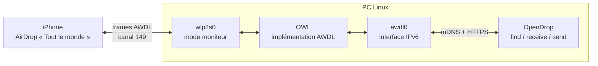

# Preuve de concept AirDrop sur Linux

Ce projet teste si un PC sous **Linux** (Fedora, carte Wi-Fi **Realtek RTL8852BE**) peut échanger des fichiers en **AirDrop** avec un iPhone, sans application côté Apple. Il s'appuie sur **OWL**, qui réimplémente le protocole Wi-Fi d'Apple (**AWDL**), et sur **OpenDrop**, qui réimplémente AirDrop par-dessus. Un script Bash enchaîne toute la mise en place et remet le Wi-Fi en état à la fin.

> **État du projet** : la couche Wi-Fi (AWDL) fonctionne sur ma carte, grâce à deux contournements, et l'iPhone voit le PC et s'y connecte. En revanche, presque rien de ce que le PC envoie à l'iPhone n'arrive : aucun fichier n'a encore été reçu. Voir [Avancement](#avancement) et [Essais réalisés](#essais-réalisés).

## Sommaire

- [Contexte](#contexte)
- [Avancement](#avancement)
- [Fonctionnement](#fonctionnement)
- [Structure du projet](#structure-du-projet)
- [Matériel](#matériel)
- [Installation](#installation)
- [Utilisation](#utilisation)
- [Essais réalisés](#essais-réalisés)
- [Contournements pour la RTL8852BE](#contournements-pour-la-rtl8852be)
- [Limites](#limites)
- [Crédits](#crédits)

## Contexte

AirDrop ne passe pas par le réseau local : il crée un réseau Wi-Fi direct entre les appareils, avec un protocole propriétaire d'Apple. Pour qu'un PC Linux y participe, sa carte Wi-Fi doit accepter des modes de fonctionnement que les pilotes grand public gèrent rarement.

Je voulais savoir si ma carte en est capable, et ce qu'il faut contourner pour y arriver. Ce dépôt rassemble mes essais, leurs résultats et un script pour refaire le test.

## Avancement

| Élément                                                           | État      |
|-------------------------------------------------------------------|-----------|
| Injection de trames par la carte Wi-Fi                            | Terminé (en 5 GHz) |
| Réception du trafic AWDL des appareils Apple                      | Terminé (avec contournement) |
| Création de l'interface `awdl0` par OWL                           | Terminé   |
| Synchronisation AWDL avec un iPhone                               | Terminé   |
| Script de preuve de concept (`find`, `receive`, `send`)           | Terminé   |
| Découverte de l'iPhone par OpenDrop (`find`)                      | Bloqué : l'iPhone n'ouvre son serveur AirDrop qu'après une annonce Bluetooth LE, qu'OpenDrop ne sait pas faire |
| L'iPhone voit le PC et s'y connecte (`receive`)                   | Terminé : connexions TLS vers le port 8771 |
| Réception d'un fichier envoyé par l'iPhone (`receive`)            | En cours : les réponses du PC à l'iPhone se perdent |
| Envoi d'un fichier vers l'iPhone (`send`)                         | Bloqué, comme `find` |

## Fonctionnement

AirDrop empile quatre briques :

1. **Bluetooth Low Energy** : annonce la présence de l'appareil et réveille les voisins ;
2. **AWDL** (Apple Wireless Direct Link) : réseau Wi-Fi pair à pair, sans point d'accès, sur les canaux 6 (2,4 GHz), 44 et 149 (5 GHz) ;
3. **mDNS / DNS-SD** : découverte du service `_airdrop._tcp` sur le réseau AWDL ;
4. **HTTPS** : échange d'identité, puis envoi du fichier sous forme d'archive.

OWL prend en charge la brique 2 et OpenDrop les briques 3 et 4. Aucun des deux ne fait l'annonce Bluetooth : il faut ouvrir la feuille de partage AirDrop sur l'iPhone pour qu'il active AWDL.



Le script `scripts/airdrop-poc.sh` :

1. lance un point d'accès éphémère sur le canal 149, puis le coupe (contournement 2) ;
2. passe la carte en mode moniteur simple sur ce canal (contournement 1) ;
3. démarre OWL en arrière-plan et attend que `awdl0` ait une adresse IPv6 ;
4. lance OpenDrop sur `awdl0`, avec les droits de l'utilisateur ;
5. à la sortie (fin normale, erreur ou Ctrl+C), arrête OWL, supprime le point d'accès et remet la carte en Wi-Fi normal.

## Structure du projet

```text
.
├── scripts/
│   ├── airdrop-poc.sh              # Preuve de concept : find, receive, send
│   ├── setup-opendrop.sh           # Environnement Python d'OpenDrop et correctifs
│   └── diagnostics/                # Scripts qui ont servi à caractériser la carte
│       ├── injection-test-2.sh     # Réception en mode moniteur et test d'injection (canal 157)
│       ├── awdl-scan.sh            # Scan passif des canaux AWDL
│       ├── channel-test.sh         # Nombre de trames reçues canal par canal
│       ├── hotspot-trick.sh        # Astuce du point d'accès sur une liste de canaux
│       ├── owl-test.sh             # OWL au premier plan, avec les deux contournements
│       └── summarize-run.sh        # Résumé du dernier essai (pairs, trames, requêtes, fichiers)
├── out/                            # Créé à l'exécution (ignoré par git)
│   ├── runs/<date>-<mode>/         # Un dossier par essai
│   │   ├── owl.log                 # Journal d'OWL
│   │   ├── opendrop.log            # Sortie d'OpenDrop
│   │   └── awdl0.pcap, wlan.pcap   # Captures, avec CAPTURE=1
│   ├── latest -> runs/…            # Dernier essai
│   └── received/                   # Fichiers reçus
├── patches/
│   └── opendrop-request-body.patch # OpenDrop : corps de requête en transfert chunked
└── README.md
```

Les scripts de `diagnostics/` sont gardés pour référence et contiennent des chemins propres à ma machine.

## Matériel

Machine de test :

| Élément        | Détail                                                     |
|----------------|------------------------------------------------------------|
| Système        | Fedora 44, noyau 7.2.15                                    |
| Carte Wi-Fi    | Realtek RTL8852BE (PCIe, 802.11ax), interface `wlp2s0`     |
| Pilote         | `rtw89_8852be`                                             |
| Firmware       | 0.29.29.18 (`linux-firmware-20261019`)                     |
| Appareil Apple | iPhone, AirDrop réglé sur « Tout le monde »                |

OWL demande à la carte bien plus qu'une connexion Wi-Fi classique :

| Fonction             | Rôle                                                              | RTL8852BE |
|----------------------|-------------------------------------------------------------------|-----------|
| Mode moniteur        | Recevoir toutes les trames du canal                               | Oui       |
| Injection de trames  | Émettre des trames AWDL                                           | Oui (testée sur le canal 157) |
| Mode moniteur actif  | Acquitter (ACK) les trames reçues, sinon l'émetteur les répète jusqu'à 7 fois | Non |
| Réception sur 6, 44 et 149 | Écouter les canaux AWDL                                     | Seulement avec le contournement 2 |

Pour vérifier une autre carte :

```bash
iw list | grep -A10 "Supported interface modes"   # "monitor" doit apparaître
iw phy phy0 info | grep -i "active monitor"        # mode moniteur actif
iw list | grep -E "\[(6|44|149)\]"                 # ni "disabled" ni "no IR"
sudo aireplay-ng --test wlp2s0                     # injection, carte en mode moniteur
```

Pour un fonctionnement sans contournement, il faut une carte avec mode moniteur actif. L'équipe d'OWL a développé avec une **Atheros AR9280** (pilote `ath9k`). Côté clés USB, la **MediaTek MT7612U** (pilote `mt76`) est réputée compatible, mais je ne l'ai pas testée.

## Installation

Dépendances (Fedora) :

```bash
sudo dnf install cmake libpcap-devel libev-devel libnl3-devel wireshark-cli aircrack-ng
```

OWL, compilé hors du dépôt :

```bash
git clone --recursive https://github.com/seemoo-lab/owl.git ~/.local/src/owl
cmake -S ~/.local/src/owl -B ~/.local/src/owl/build -DCMAKE_POLICY_VERSION_MINIMUM=3.5
make -C ~/.local/src/owl/build owl
```

OpenDrop, dans un environnement virtuel à la racine du dépôt (`.venv`), avec les correctifs de `patches/` :

```bash
bash scripts/setup-opendrop.sh
```

Points à connaître :

- `-DCMAKE_POLICY_VERSION_MINIMUM=3.5` est nécessaire avec CMake 4, à cause des sous-modules d'OWL ;
- je compile seulement la cible `owl` : les tests d'OWL (googletest) ne compilent plus avec un GCC récent, ce qui n'affecte pas le binaire ;
- `setuptools<81` fournit `pkg_resources`, qu'OpenDrop importe encore et qui n'existe plus dans les environnements Python récents (testé avec Python 3.14) ;
- l'iPhone envoie ses requêtes `/Discover` et `/Ask` sans en-tête `Content-Length`, a priori en transfert *chunked*. OpenDrop 0.13.0 plante alors (`int() argument must be ... not 'NoneType'`) ; `patches/opendrop-request-body.patch` lui apprend à lire ces requêtes. Le script peut être relancé sans risque : il saute les correctifs déjà appliqués ;
- le pare-feu de Fedora Workstation ouvre les ports 1025 à 65535, donc le port 8771 d'OpenDrop et le mDNS passent sans réglage.

## Utilisation

Depuis la racine du dépôt, avec l'iPhone en AirDrop « Tout le monde » et la feuille de partage ouverte :

```bash
sudo bash scripts/airdrop-poc.sh find           # lister les appareils AirDrop à portée
sudo bash scripts/airdrop-poc.sh receive        # être visible et recevoir des fichiers
sudo bash scripts/airdrop-poc.sh send FICHIER   # chercher 30 s, puis envoyer à l'appareil 0
```

Le Wi-Fi habituel est coupé pendant l'essai et rétabli à la sortie. Les clés et le certificat d'OpenDrop sont générés au premier lancement dans `~/.opendrop/`.

Chaque essai garde ses journaux dans son propre dossier `out/runs/`, et `out/latest` désigne le dernier. Après un essai lancé avec `CAPTURE=1`, `bash scripts/diagnostics/summarize-run.sh [DOSSIER]` (sans `sudo`, dernier essai par défaut) résume ce qui s'est passé : pairs AWDL vus par OWL, trames reçues de chacun et force du signal, requêtes de l'iPhone sur `awdl0`, sortie d'OpenDrop et fichiers reçus.

Options, à passer en variables d'environnement :

| Variable       | Défaut                              | Rôle                                   |
|----------------|-------------------------------------|----------------------------------------|
| `IFACE`        | `wlp2s0`                            | Interface Wi-Fi                        |
| `CHANNEL`      | `149`                               | Canal AWDL (44 ou 6 possibles)         |
| `DEVICE_NAME`  | `poc`                               | Nom affiché sur l'iPhone (`receive`)   |
| `FIND_SECONDS` | `30`                                | Durée de recherche avant un `send`     |
| `CAPTURE`      | `0`                                 | `1` : enregistre le trafic de `awdl0` (`awdl0.pcap`) et les trames Wi-Fi brutes (`wlan.pcap`) dans le dossier de l'essai |
| `OWL_ARGS`     | (vide)                              | Options en plus pour OWL, par exemple `-f -vv` (sans filtre RSSI, journal détaillé) |
| `OPENDROP_ARGS`| (vide)                              | Options en plus pour OpenDrop, par exemple `-d` (débogage) |
| `TCP_MSS`      | `0`                                 | Taille maximale des segments TCP envoyés à l'iPhone (`0` : pas de limite), voir le contournement 3 |
| `OWL_BIN`      | `~/.local/src/owl/build/daemon/owl` | Binaire OWL                            |

Exemple : `sudo CHANNEL=44 bash scripts/airdrop-poc.sh find`.

## Essais réalisés

| #  | Essai                                              | Résultat                                            | Conclusion |
|----|----------------------------------------------------|-----------------------------------------------------|------------|
| 1  | Injection, canal 6 (`aireplay-ng --test`)          | « No Answer, Found 0 APs »                          | Non concluant |
| 2  | Injection, canal 157                               | « Injection is working! », 6 points d'accès         | L'injection fonctionne en 5 GHz |
| 3  | OWL avec ses réglages par défaut                   | `Could not put device in monitor mode`              | Pas de mode moniteur actif dans `rtw89` |
| 4  | OWL en mode moniteur simple (`-N`), canal 149      | `awdl0` créé, aucun pair                            | L'iPhone n'est pas vu |
| 5  | Scan passif sur 6, 44, 149 et 157                  | 157 : environ 900 trames, les autres : 0 à 1        | La carte ne reçoit pas sur ces canaux |
| 6  | Réception canal par canal (6, 11, 48, 112, 149, 157) | Seul le 157 reçoit, alors que des points d'accès émettent sur 6, 48 et 112 | La carte ne reçoit que sur le dernier canal utilisé par le firmware |
| 7  | Point d'accès éphémère, puis mode moniteur         | Réception sur 149, 44 et 6, trames AWDL décodées    | Contournement trouvé |
| 8  | OWL avec les deux contournements, canal 149        | `add peer`, synchronisation avec l'iPhone           | La couche AWDL fonctionne |
| 9  | `find`, feuille de partage ouverte sur l'iPhone    | Aucun appareil trouvé                               | Limite connue d'OpenDrop : pas d'annonce Bluetooth LE pour réveiller le récepteur |
| 10 | `receive`                                          | `Address not available when binding to (fe80::…, 5353…)` | `zeroconf` ne peut pas s'attacher à une adresse IPv6 encore *tentative* et abandonne `awdl0` : le script attend maintenant la fin de la détection d'adresse dupliquée |
| 11 | `receive`, `OWL_ARGS="-f -vv"`                     | L'iPhone voit « poc », ouvre une connexion TLS et envoie `POST /Discover` ; OpenDrop plante (`Content-Length` absent) | Seul essai où la réponse TLS du PC est passée. Correctif `patches/opendrop-request-body.patch` |
| 12 | `receive`, `OWL_ARGS="-f -vv"`, deux fois          | Aucune donnée de l'iPhone ; OWL bascule plusieurs fois entre l'iPhone (−37 dBm) et un appareil lointain (−87 dBm) | `-f` (pas de filtre RSSI) fait suivre à OWL des appareils trop lointains |
| 13 | `receive`, sans `-f`                               | Synchronisation stable, 7 connexions TLS de l'iPhone, aucune réponse du PC acquittée | L'iPhone reçoit nos petits paquets (SYN-ACK) mais pas la réponse TLS |
| 14 | `receive`, sans `-f`, `TCP_MSS=500`                | Réponse TLS découpée en segments de 488 octets, toujours rien d'acquitté | La taille des segments n'est pas la cause |

Remarques :

- pour repérer les trames AWDL, j'utilise le dissecteur `awdl` de `tshark` : mon filtre `tcpdump` écrit à la main ne trouvait rien ;
- les appareils Apple utilisent des adresses MAC aléatoires et des noms d'hôte en UUID, donc je ne peux pas toujours dire lequel est mon iPhone ;
- l'iPhone suivait la séquence de canaux 48, 149 et 6. OWL reste sur le 149, ce qui suffit pour se synchroniser ;
- pour les essais 13 et 14, l'iPhone envoie des accusés de réception Wi-Fi à certaines de nos trames, mais je ne peux pas les associer de façon fiable aux trames émises : la capture horodate nos trames quand elles sont confiées à la carte, pas quand elles partent ;
- ma piste principale est le moment d'émission : si le firmware émet les trames injectées en retard, elles tombent hors des courtes fenêtres où l'iPhone écoute le canal. Une carte avec un autre pilote permettrait de trancher.

## Contournements pour la RTL8852BE

### 1. Pas de mode moniteur actif

Je passe moi-même la carte en mode moniteur simple, puis je lance OWL avec `-N` pour qu'il ne touche pas à sa configuration :

```bash
ip link set wlp2s0 down
iw dev wlp2s0 set type monitor
ip link set wlp2s0 up
owl -i wlp2s0 -c 149 -N
```

Contrepartie : sans ACK, le débit de transfert sera dégradé.

### 2. Réception limitée au dernier canal

En mode moniteur, la carte accepte le changement de canal mais ne reçoit presque rien sur le nouveau. Je fais donc d'abord travailler le firmware sur le canal voulu avec un point d'accès éphémère :

```bash
nmcli device wifi hotspot ifname wlp2s0 band a channel 149 ssid poc-tmp password <mot-de-passe>
nmcli connection down Hotspot
nmcli device set wlp2s0 managed no
# puis le contournement 1, et :
iw dev wlp2s0 set channel 149
```

Ce comportement du firmware n'est pas documenté : une mise à jour du noyau ou du firmware peut le corriger, ou casser le contournement.

### 3. Limiter la taille des segments TCP (piste écartée, option gardée)

Pendant l'essai 13, nos segments de 1 043 et 1 378 octets (la réponse TLS) étaient retransmis pendant 5 secondes sans arriver, alors que les petits paquets passaient. Avec `TCP_MSS=500`, le script fait croire au noyau que l'iPhone n'accepte que des segments de 500 octets, en réécrivant l'option MSS des SYN qu'il reçoit (règle nftables dans la table `airdrop_poc`, supprimée à la sortie). L'essai 14 montre que ça ne suffit pas, donc l'option est désactivée par défaut :

```bash
nft add table inet airdrop_poc
nft add chain inet airdrop_poc prerouting '{ type filter hook prerouting priority mangle; }'
nft add rule inet airdrop_poc prerouting iifname awdl0 'tcp flags & (syn | ack) == syn' tcp option maxseg size set 500
```

## Limites

- Peu de cartes intégrées gèrent le mode moniteur avec injection, et la mienne demande deux contournements non documentés
- Le Wi-Fi habituel est coupé tant qu'AWDL tourne, car la carte lui est dédiée
- Sans certificat signé par Apple, l'iPhone ne voit le PC qu'en mode « Tout le monde », qui se désactive seul au bout de 10 minutes
- OWL (dernier commit de code en janvier 2022) et OpenDrop (avril 2021) ne sont plus maintenus : une mise à jour d'iOS peut tout casser
- Le mode moniteur et OWL demandent les droits root

## Crédits

- [OWL](https://github.com/seemoo-lab/owl) et [OpenDrop](https://github.com/seemoo-lab/opendrop), du [Secure Mobile Networking Lab](https://owlink.org/) (TU Darmstadt)

AirDrop est une marque d'Apple Inc. Ce projet n'est ni affilié à Apple ni approuvé par Apple.
