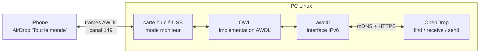

<!-- clean-readme: type=recherche; langue=fr; v=2 -->
# Preuve de concept AirDrop sur Linux

Ce projet teste si un PC sous Linux (Fedora, carte Wi-Fi Realtek RTL8852BE) peut échanger des fichiers en AirDrop avec un iPhone, sans application côté Apple. Il s'appuie sur OWL, qui réimplémente le protocole Wi-Fi d'Apple (AWDL), et sur OpenDrop, qui réimplémente AirDrop par-dessus. Un script Bash enchaîne la mise en place et remet le Wi-Fi en état à la fin. Avec la carte intégrée, l'iPhone voit le PC mais aucun fichier ne passe. Avec une clé USB MediaTek MT7612U, le PC reçoit des photos envoyées par l'iPhone.

> **État** : En cours. Avec la clé USB MT7612U, le PC reçoit des fichiers de l'iPhone, y compris après une fermeture et une réouverture de la feuille de partage. L'envoi depuis le PC reste bloqué par l'annonce Bluetooth LE.

## Avertissement

Ce dépôt est un travail d'étude personnel sur un protocole propriétaire, fait pour l'interopérabilité entre mes propres appareils. Ce projet n'est ni affilié à Apple Inc. ni approuvé par Apple. Les scripts passent la carte Wi-Fi choisie en mode moniteur, émettent des trames brutes et demandent les droits root : cette carte ne sert plus au Wi-Fi habituel pendant les essais.

## Sommaire

- [Avertissement](#avertissement)
- [Contexte](#contexte)
- [Question de recherche](#question-de-recherche)
- [Avancement](#avancement)
- [Résultats principaux](#résultats-principaux)
- [Méthode](#méthode)
- [Reproduire](#reproduire)
- [Structure du dépôt](#structure-du-dépôt)
- [Matériel](#matériel)
- [Questions ouvertes](#questions-ouvertes)
- [Limites](#limites)
- [Crédits](#crédits)

## Contexte

AirDrop ne passe pas par le réseau local. Il crée un réseau Wi-Fi direct entre les appareils, avec un protocole propriétaire d'Apple. Pour qu'un PC Linux y participe, sa carte Wi-Fi doit accepter des modes de fonctionnement que les pilotes grand public gèrent rarement.

## Question de recherche

Une carte Wi-Fi intégrée courante, ici la RTL8852BE avec le pilote `rtw89`, peut-elle faire tourner AWDL et échanger un fichier AirDrop avec un iPhone ? Si oui, que faut-il contourner pour y arriver ? Sinon, une clé USB courante suffit-elle ?

## Avancement

Avec la carte intégrée, la couche AWDL fonctionne grâce à deux contournements, et l'iPhone ouvre des connexions TLS vers le PC. Les réponses du PC se perdent, donc aucun fichier ne passe.

Avec la clé USB MT7612U en mode moniteur simple, les réponses du PC arrivent. Le 2026-11-25, j'ai reçu des photos et un PDF de l'iPhone, après avoir décodé le format `x-dvzip` des iOS récents. Le PC se réannonce quand l'iPhone revient, donc plusieurs envois passent sans relancer le script. Le script ne touche qu'à la clé, et la carte intégrée reste connectée. Les photos arrivent dans leur format d'origine (HEIC), mais les vidéos HEVC sont converties en H.264 et les Live Photos arrivent sans leur vidéo. Restent à faire : ces deux formats, les fichiers de même nom et la mesure du débit. Les modes `find` et `send` sont toujours bloqués par l'absence d'annonce Bluetooth LE dans OpenDrop. Détail dans [ROADMAP.md](ROADMAP.md).

## Résultats principaux

1. **R1** : la RTL8852BE injecte des trames en 5 GHz (canal 157), mais n'a pas de mode moniteur actif. [Détail](RESULTATS.md#r1)
2. **R2** : en mode moniteur, la carte ne reçoit que sur le dernier canal utilisé par le firmware. Un point d'accès éphémère sur le canal voulu contourne le problème. [Détail](RESULTATS.md#r2)
3. **R3** : avec ces deux contournements, OWL se synchronise avec l'iPhone, qui voit le PC et ouvre des connexions TLS. [Détail](RESULTATS.md#r3)
4. **R4** : les réponses TLS du PC n'arrivent pas à l'iPhone. La taille des segments TCP n'est pas la cause. [Détail](RESULTATS.md#r4)
5. **R5** : `find` et `send` ne trouvent pas l'iPhone, qui n'ouvre son serveur AirDrop qu'après une annonce Bluetooth LE. [Détail](RESULTATS.md#r5)
6. **R6** : avec une clé USB MT7612U en mode moniteur simple, les réponses du PC arrivent et le PC reçoit des photos de l'iPhone (3,6 Mo à 0,93 Mo/s). Le mode moniteur actif de la clé empêche au contraire l'iPhone d'envoyer ([R7](RESULTATS.md#r7)). Les iOS récents envoient les fichiers au format `x-dvzip`, décodé dans [R8](RESULTATS.md#r8). Une réannonce mDNS fait revoir le PC à l'iPhone quand il revient ([R9](RESULTATS.md#r9)). Les photos arrivent en HEIC, mais les vidéos sont encore converties ([R10](RESULTATS.md#r10)). [Détail](RESULTATS.md#r6)

Les 25 essais et les pistes écartées sont dans [RESULTATS.md](RESULTATS.md).

## Méthode

AirDrop empile quatre briques : Bluetooth LE (annonce), AWDL (réseau Wi-Fi pair à pair sur les canaux 6, 44 et 149), mDNS / DNS-SD (service `_airdrop._tcp`) et HTTPS (échange d'identité, puis fichier). OWL prend en charge AWDL, OpenDrop le mDNS et le HTTPS. Aucun des deux ne fait l'annonce Bluetooth : il faut ouvrir la feuille de partage AirDrop sur l'iPhone pour qu'il active AWDL.



J'observe chaque essai avec les journaux d'OWL et d'OpenDrop, et avec des captures `tshark` de `awdl0` et des trames Wi-Fi brutes. Le détail du script et du protocole est dans [RESULTATS.md](RESULTATS.md#méthode).

## Reproduire

### Prérequis

- Linux avec une carte Wi-Fi qui accepte le mode moniteur et l'injection (voir [Matériel](#matériel))
- `cmake`, `libpcap-devel`, `libev-devel`, `libnl3-devel`, `wireshark-cli` (`tshark`), `aircrack-ng`, `iw`, `nmcli`, `nft`, `patch`, Python 3
- OWL compilé dans `~/.local/src/owl`, OpenDrop 0.13.0 avec les correctifs de `patches/`
- Un iPhone avec AirDrop réglé sur "Tout le monde"
- Testé sur : Fedora 44, noyau 7.2.15, Python 3.14

Installation :

```bash
sudo dnf install cmake libpcap-devel libev-devel libnl3-devel wireshark-cli aircrack-ng
git clone --recursive https://github.com/seemoo-lab/owl.git ~/.local/src/owl
cmake -S ~/.local/src/owl -B ~/.local/src/owl/build -DCMAKE_POLICY_VERSION_MINIMUM=3.5
make -C ~/.local/src/owl/build owl
bash scripts/setup-opendrop.sh
```

Les raisons de ces réglages (CMake 4, `setuptools<81`, correctif d'OpenDrop) sont dans [docs/GUIDE.md](docs/GUIDE.md#installation).

Lancement, depuis la racine du dépôt, avec la feuille de partage ouverte sur l'iPhone :

```bash
sudo bash scripts/airdrop-poc.sh find
sudo CAPTURE=1 bash scripts/airdrop-poc.sh receive
sudo bash scripts/airdrop-poc.sh send FICHIER
bash scripts/diagnostics/summarize-run.sh
```

`find` liste les appareils à portée, `receive` rend le PC visible, `send` cherche 30 s puis envoie à l'appareil 0. `summarize-run.sh`, lancé sans `sudo` après un essai avec `CAPTURE=1`, résume les pairs vus, les trames reçues, les requêtes de l'iPhone et les fichiers reçus. Sans `IFACE`, le script utilise la carte intégrée `wlp2s0` : le Wi-Fi habituel est coupé pendant l'essai et rétabli à la sortie.

Réception avec la clé USB (R6), le Wi-Fi habituel restant connecté. Le nom de l'interface de la clé est donné par `iw dev` :

```bash
sudo IFACE=wlp4s0f4u1 CAPTURE=1 bash scripts/airdrop-poc.sh receive
```

Les fichiers reçus arrivent dans `out/received/`. Les options (interface, canal, captures, arguments d'OWL) sont dans [docs/GUIDE.md](docs/GUIDE.md#configuration-et-options).

## Structure du dépôt

```text
scripts/
    airdrop-poc.sh                # preuve de concept : find, receive, send
    setup-opendrop.sh             # environnement Python d'OpenDrop et correctifs
    diagnostics/                  # scripts qui ont servi à caractériser les cartes
patches/
    opendrop-request-body.patch   # OpenDrop : corps de requête en transfert chunked
    opendrop-dvzip.patch          # OpenDrop : fichiers reçus au format x-dvzip
    opendrop-reannounce.patch     # OpenDrop : réannonce du service sur SIGUSR1
    opendrop-media-capabilities.patch  # OpenDrop : formats annoncés comme un Mac (photos en HEIC)
docs/
    GUIDE.md                      # installation détaillée, options, vérifier une carte
out/                              # créé à l'exécution, ignoré par git : journaux, captures, fichiers reçus
RESULTATS.md                      # résultats, essais, pistes écartées
ROADMAP.md                        # feuille de route
```

Les scripts de `diagnostics/` sont gardés pour référence et contiennent des chemins propres à ma machine.

## Matériel

| Élément        | Détail                                                 |
|----------------|--------------------------------------------------------|
| Système        | Fedora 44, noyau 7.2.15                                |
| Carte Wi-Fi    | Realtek RTL8852BE (PCIe, 802.11ax), interface `wlp2s0` |
| Pilote         | `rtw89_8852be`                                         |
| Firmware       | 0.29.29.18 (`linux-firmware-20261019`)                 |
| Clé USB        | COMFAST CF-922AC, MediaTek MT7612U (`0e8d:7612`), pilote `mt76x2u` |
| Appareil Apple | iPhone, AirDrop réglé sur "Tout le monde"              |

OWL demande à la carte bien plus qu'une connexion Wi-Fi classique :

| Fonction                   | Rôle                                                   | RTL8852BE | MT7612U (clé USB) |
|----------------------------|--------------------------------------------------------|-----------|-------------------|
| Mode moniteur              | Recevoir toutes les trames du canal                    | Oui | Oui |
| Injection de trames        | Émettre des trames AWDL                                | Oui (testée sur le canal 157) | Oui (canaux 6, 44 et 149) |
| Mode moniteur actif        | Acquitter (ACK) les trames reçues                      | Non | Oui, mais l'iPhone n'envoie alors rien ([R7](RESULTATS.md#r7)) |
| Réception sur 6, 44 et 149 | Écouter les canaux AWDL                                | Seulement avec le contournement de [R2](RESULTATS.md#r2) | Oui, sans contournement |

L'équipe d'OWL a développé avec une Atheros AR9280 (pilote `ath9k`). Avec la MT7612U, le mode moniteur simple suffit pour recevoir un fichier. Les commandes pour vérifier une autre carte sont dans [docs/GUIDE.md](docs/GUIDE.md#matériel).

## Questions ouvertes

- Pourquoi l'iPhone convertit-il encore les vidéos HEVC en H.264 et envoie-t-il les Live Photos sans leur vidéo ?
- Quel débit obtient-on sur plusieurs envois, et avec des fichiers plus gros ?
- Pourquoi l'iPhone n'envoie-t-il rien quand la clé est en mode moniteur actif ?

Les essais prévus sont dans [RESULTATS.md](RESULTATS.md#questions-ouvertes).

## Limites

- Peu de cartes intégrées gèrent le mode moniteur avec injection, et la mienne demande deux contournements non documentés
- La carte qui fait tourner AWDL lui est dédiée : avec la carte intégrée, le Wi-Fi habituel est coupé, d'où l'intérêt d'une clé USB
- Sans certificat signé par Apple, l'iPhone ne voit le PC qu'en mode "Tout le monde", qui se désactive seul au bout de 10 minutes
- OWL (dernier commit de code en janvier 2022) et OpenDrop (avril 2021) ne sont plus maintenus : une mise à jour d'iOS peut tout casser
- Le mode moniteur et OWL demandent les droits root

## Crédits

- [OWL](https://github.com/seemoo-lab/owl) et [OpenDrop](https://github.com/seemoo-lab/opendrop), du [Secure Mobile Networking Lab](https://github.com/seemoo-lab) (TU Darmstadt)

AirDrop est une marque d'Apple Inc. Ce projet n'est ni affilié à Apple ni approuvé par Apple.
